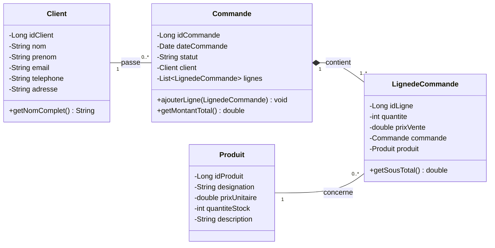

# Gestion des Commandes - Application Web JEE (MVC 1)

Application web de gestion des clients, des produits et des commandes multi-produits avec gestion transactionnelle du stock (ACID), développée selon le patron d'architecture **MVC 1** en **Jakarta EE 10**.

---

## 1. Architecture du Projet

Le projet respecte le patron **MVC 1** avec séparation claire des responsabilités :

```text
Atelier1_Gestion_commandes/
|-- src/main/java/ma/fstt/
|   |-- entities/        # Modèle : Classes métiers (POJOs / JavaBeans)
|   |   |-- Client.java
|   |   |-- Produit.java
|   |   |-- Commande.java
|   |   `-- LignedeCommande.java
|   |
|   |-- service/         # Interfaces DAO génériques et spécifiques
|   |   |-- IDao.java
|   |   |-- IClientDao.java
|   |   |-- IProduitDao.java
|   |   `-- ICommandeDao.java
|   |
|   |-- dao/             # Accès aux données JDBC & Connexion MySQL
|   |   |-- DbConnection.java      (Gestionnaire de connexion JDBC)
|   |   |-- ClientDaoImpl.java     (CDI @ApplicationScoped)
|   |   |-- ProduitDaoImpl.java    (CDI @ApplicationScoped)
|   |   `-- CommandeDaoImpl.java   (Gestion transactionnelle ACID)
|   |
|   `-- presentation/    # Contrôleurs HTTP (Servlets Jakarta EE & Filtre)
|       |-- ClientServlet.java     (@WebServlet("/clients"))
|       |-- ProduitServlet.java    (@WebServlet("/produits"))
|       |-- CommandeServlet.java   (@WebServlet("/commandes"))
|       `-- EncodingFilter.java    (Filtre UTF-8)
|
|-- src/main/webapp/     # Vues (JSP / JSTL)
|   |-- index.jsp        (Page d'accueil)
|   |-- includes/        (header.jsp, footer.jsp)
|   |-- clients/         (index.jsp, form.jsp)
|   |-- produits/        (index.jsp, form.jsp)
|   |-- commandes/       (index.jsp, create.jsp, details.jsp)
|   `-- WEB-INF/         (web.xml, beans.xml)
|
|-- database.sql         # Script SQL de création de la base et des tables
`-- pom.xml              # Configuration Maven (Jakarta EE 10, Java 21)

```

---

## 2. Diagramme de Classes UML



---

## 3. Base de Données

Le script complet de création de la base et des tables est disponible dans le fichier [`database.sql`](./database.sql).

### Tables :
- `client` : Coordonnées des clients.
- `produit` : Catalogue des articles avec contrainte de stock `CHECK (quantite_stock >= 0)`.
- `commande` : Commandes passées par les clients.
- `ligne_commande` : Lignes associées aux commandes avec prix de vente historisé et quantité commandée.
